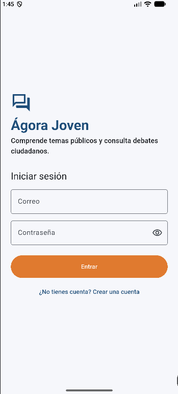
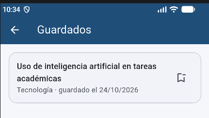
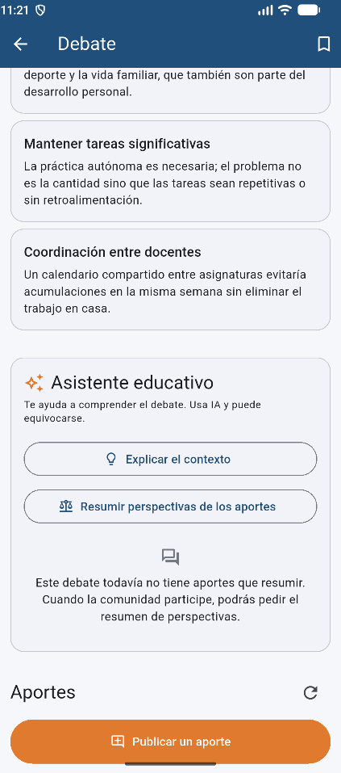

# Ágora Joven

App Android (Flutter) para que personas jóvenes **comprendan temas públicos**, **consulten debates
ciudadanos** y **publiquen preguntas, argumentos o propuestas**, con un backend propio (FastAPI) y
un asistente educativo con IA (Gemini) que explica el contexto y resume perspectivas.

Proyecto Final del curso *Desarrolla Aplicaciones Móviles Robustas con Flutter e IA* (CEDIA). Los
20 debates son **material editorial de demostración** redactado para este proyecto.

> Estado y evidencias de cada bloque: [docs/SEGUIMIENTO.md](docs/SEGUIMIENTO.md).

## Capturas de pantalla

Capturas reales de las **pruebas de desarrollo** de la persona autora en el emulador Android, con
la app ejecutada desde el código contra el backend Docker. **Todavía no corresponden al APK de la
GitHub Release.** Los nombres visibles ("Jleiva", "patu") son cuentas de prueba.

| Acceso | Catálogo | Aportes de dos cuentas |
|---|---|---|
|  |  |  |

| Guardados | Asistente: explicación del contexto | Asistente: sin aportes que resumir |
|---|---|---|
|  |  |  |

## Qué incluye

- [x] Registro, inicio y cierre de sesión con JWT del backend propio; token en almacenamiento
      seguro; la sesión se restaura al abrir la app.
- [x] Catálogo de 20 debates guardados en SQLite del backend, con filtro por categoría y estados de
      carga, vacío y error.
- [x] Aportes (pregunta, argumento o propuesta) visibles para todas las cuentas; solo su autor puede
      editarlos o eliminarlos (403 comprobado en el servidor).
- [x] Debates guardados con Hive, separados por cuenta, que sobreviven al cierre completo de la app.
- [x] Asistente educativo con Gemini **a través del backend**: explicar el contexto y resumir los
      aportes; sin claves en la app y sin publicar nada automáticamente.
- [x] Estado compartido con GetX y arquitectura en capas.
- [x] CI y Release del APK con GitHub Actions (`.github/workflows/`).

## Requisitos y versiones comprobadas

| Herramienta | Versión |
|---|---|
| Flutter / Dart | 3.47.5 / 3.13.4 (canal stable) |
| Docker / Docker Compose | 29.8.2 / v5.6.0 (Docker Desktop en ejecución) |
| Python del contenedor y de CI | 3.12 (`python:3.12-slim`; comprobado 3.12.15) |
| Python local (opcional, desarrollo sin Docker) | 3.11.9 |
| Android | Emulador con API 24 o superior (minSdk 24) |

## Puesta en marcha desde un clon limpio

### 1. Clonar

```powershell
git clone https://github.com/jleivalabs/agora-joven.git
cd agora-joven
```

### 2. Configurar los secretos del backend (solo en tu equipo)

```powershell
cd backend
Copy-Item .env.example .env
python -c "import secrets; print(secrets.token_urlsafe(48))"
```

Abre `backend/.env` en tu editor:

- `JWT_SECRET=` → pega el valor generado. **Obligatorio**: sin él, Compose no arranca la API.
- `GEMINI_API_KEY=` → opcional. Crea la clave en
  [Google AI Studio](https://aistudio.google.com/app/apikey) y pégala solo aquí. Sin clave todo
  funciona salvo el asistente, que responde "no está configurado".

`backend/.env` está en `.gitignore`: no lo compartas, no lo subas y no pegues sus valores en chats
ni capturas.

### 3. Arrancar el backend con Docker y comprobar /health

```powershell
docker compose up --build -d api
docker compose ps                     # agora-joven-api debe aparecer como (healthy)
curl.exe http://localhost:8010/health
# {"status":"ok","servicio":"agora-joven-api"}
```

- Puerto del host: `8010`. La base SQLite vive en el volumen `agora-joven_agora_datos` y sobrevive
  a `docker compose down` y a recrear el contenedor. **`docker compose down -v` borra el volumen**.
- Al arrancar se crean las tablas y se cargan los 20 debates (carga idempotente).
- Documentación interactiva de la API: `http://localhost:8010/docs`.

### 4. Instalar el APK de la Release

1. Descarga de [Releases](https://github.com/jleivalabs/agora-joven/releases) los archivos
   `agora-joven-vX.Y.Z-emulador.apk` y `agora-joven-vX.Y.Z-emulador.apk.sha256`.
2. Verifica la descarga (el valor debe coincidir con el del archivo `.sha256`):

   ```powershell
   Get-FileHash .\agora-joven-v1.0.0-emulador.apk -Algorithm SHA256
   Get-Content .\agora-joven-v1.0.0-emulador.apk.sha256
   ```

3. Con el emulador abierto, instala (si había otra versión firmada con otra clave, desinstálala):

   ```powershell
   adb uninstall ec.edu.ute.agora_joven      # solo si ya estaba instalada
   adb install .\agora-joven-v1.0.0-emulador.apk
   ```

   Desinstalar la app borra lo que guarda **en el dispositivo**: la sesión (token) y los debates
   guardados con Hive. **No** borra nada del backend: cuentas, aportes y debates siguen en el
   volumen Docker. Tras reinstalar, inicia sesión de nuevo y vuelve a guardar los debates.

**Dirección del backend de ese APK:** `http://10.0.2.2:8010`. `10.0.2.2` es tu equipo visto desde el
**emulador Android**; por eso el APK de la Release solo funciona en el emulador con el backend del
paso 3 en marcha. Un teléfono físico necesita compilar otra vez con la IP del equipo (ver
"Ejecutar desde el código").

### 5. Ejecutar desde el código (alternativa al APK)

```powershell
cd app
flutter pub get
flutter run --dart-define=API_BASE_URL=http://10.0.2.2:8010
```

| Entorno | `API_BASE_URL` | Notas |
|---|---|---|
| Emulador Android | `http://10.0.2.2:8010` (por defecto) | Permitido en `network_security_config.xml` |
| Teléfono físico en la misma red | `http://<IP-del-PC>:8010` | Añadir esa IP a `app/android/app/src/main/res/xml/network_security_config.xml` o usar HTTPS |

## Recorrido de prueba (dos cuentas)

1. Abre la app → "Crear una cuenta" → registra la cuenta A → inicia sesión.
2. Catálogo: filtra por una categoría y vuelve a "Todas". Abre un debate: contexto, perspectivas y
   aviso editorial.
3. **Guardados:** pulsa el marcador del detalle → vuelve al catálogo → icono "Guardados".
   Cierra la app por completo (desde recientes o `adb shell am force-stop ec.edu.ute.agora_joven`),
   ábrela: la sesión se restaura y el debate sigue en Guardados.
4. **Aportes:** en el debate, "Publicar un aporte" (tipo y texto de 10 a 1000 caracteres). Edítalo.
5. **Asistente:** "Explicar el contexto" y "Resumir perspectivas de los aportes" (requiere la clave
   de Gemini en el backend; cada consulta es una llamada real al proveedor).
6. Menú de cuenta → "Cerrar sesión". Registra la cuenta B e inicia sesión.
7. Con B: Guardados está vacío; en el mismo debate ves el aporte de A **sin** Editar ni Eliminar.
   Publica un aporte propio.
8. Vuelve a A y pulsa "Actualizar aportes": ves los dos, el más reciente primero. Elimina el tuyo
   (pide confirmación); el de B se conserva.
9. Errores: con la app abierta, `docker compose stop api` y actualiza: mensaje de error con
   "Reintentar"; `docker compose start api` y reintenta. Guardados sigue disponible sin backend.

## Arquitectura

```text
app/lib/
├── screens/       pantallas y secciones (solo interfaz)
├── controllers/   estado compartido con GetX (sesión, debates, aportes, guardados, asistente)
├── repositories/  reglas de acceso y conversión a modelos
├── data/          ApiClient (Dio), TokenStorage (flutter_secure_storage), Hive
├── models/        Usuario, Debate, Aporte, DebateGuardado, RespuestaAsistente
└── widgets/       estados de carga/vacío/error, Markdown seguro

backend/app/
├── routers/       auth, debates, aportes, asistente
├── repositorios/  consultas SQLAlchemy
├── models.py      Usuario, Debate, Aporte (SQLite)
├── security.py    Argon2id, JWT y usuario actual
└── ia.py          cliente REST de Gemini (sin SDK)
```

Un dato viaja así: la pantalla llama a un controlador GetX; el controlador pide la operación a un
repositorio a través de `SesionController.ejecutar` (que añade el token y descarta respuestas de
sesiones anteriores); el repositorio usa `ApiClient` (Dio) y convierte el JSON en modelos; el
controlador actualiza sus observables y `Obx` repinta la pantalla con el estado de carga, vacío,
datos o error. Ninguna pantalla llama a HTTP, Hive ni al almacenamiento seguro.

Detalle de capas, contrato de la API y decisiones: [docs/ARQUITECTURA.md](docs/ARQUITECTURA.md).
Alcance y correspondencia con la rúbrica: [docs/ALCANCE.md](docs/ALCANCE.md).

## Decisiones técnicas propias

- **Contador de sesión contra respuestas tardías.** Cada operación captura el número de sesión al
  empezar y solo aplica su resultado si no cambió: una respuesta de la cuenta A nunca altera la
  cuenta B, un 401 antiguo no cierra la sesión nueva y varios 401 simultáneos producen un solo
  aviso. Se descartó confiar solo en cancelar peticiones, que no cubre escrituras ya enviadas.
- **Propiedad de los aportes solo en el servidor.** El autor sale del token; el cuerpo rechaza
  `autor_id`/`debate_id` (422) y editar o borrar lo ajeno da 403. Los botones de la app son solo
  cortesía visual.
- **SQLite en un volumen Docker** en lugar de PostgreSQL: un único servicio que levantar para quien
  evalúa, suficiente para la escala del proyecto.
- **Gemini por REST con la biblioteca estándar** en lugar del SDK: sin dependencias nuevas, tiempo
  máximo de espera explícito y errores clasificados (429/502/503) sin respuestas de reserva.

## Tecnologías

| App | Versión | Uso |
|---|---|---|
| `get` | 4.7.3 | Estado (GetxController) y navegación |
| `dio` | 5.11.1 | HTTP con límites de tiempo |
| `flutter_secure_storage` | 11.2.0 | Token cifrado (Keystore de Android) |
| `hive` / `hive_flutter` | 2.2.3 / 1.1.0 | Debates guardados por cuenta |
| `flutter_markdown_plus` | 1.0.12 | Respuestas del asistente con formato, sin HTML, imágenes ni enlaces activos |

| Backend | Versión | Uso |
|---|---|---|
| FastAPI / Starlette / Uvicorn | 0.142.2 / 1.7.0 / 0.54.0 | API |
| Pydantic / pydantic-settings | 2.13.5 / 2.15.0 | Validación y configuración desde el entorno |
| SQLAlchemy | 2.1.1 | SQLite con claves foráneas |
| PyJWT / pwdlib[argon2] | 2.15.1 / 0.3.1 | Tokens HS256 y contraseñas Argon2id |
| email-validator | 2.3.0 | Correo del registro |
| pytest / httpx2 | 9.1.1 / 2.13.1 | Pruebas (solo desarrollo) |

## Integración continua y Release

- `.github/workflows/ci.yml` — en cada push y pull request: Flutter (`pub get --enforce-lockfile`,
  `flutter analyze`, `flutter test`) y backend (Python 3.12, dependencias fijadas, `pytest`). Sin
  `.env`, sin claves y sin llamadas reales a IA. Permisos de solo lectura.
- `.github/workflows/release.yml` — al subir una etiqueta `v*`: vuelve a probar backend y app,
  comprueba que la etiqueta coincida con la versión de `pubspec.yaml`, compila el APK release con
  `API_BASE_URL=http://10.0.2.2:8010` y publica una GitHub Release con
  `agora-joven-vX.Y.Z-emulador.apk` y su `.sha256`. Solo el trabajo que publica tiene permiso de
  escritura.

## Seguridad

- No hay claves en el repositorio: `.env` está ignorado y solo se versiona `.env.example` con
  valores vacíos. `JWT_SECRET` y `GEMINI_API_KEY` viven solo en `backend/.env` del equipo que
  ejecuta el backend; ni GitHub Actions, ni la app, ni el APK los contienen.
- Contraseñas con Argon2id; ninguna respuesta devuelve contraseña, hash ni correo de otras personas.
- Solo el token se guarda en la app (`flutter_secure_storage`); no se registran cuerpos, tokens ni
  la cabecera `Authorization`. Uvicorn registra método, ruta y código.
- Al proveedor de IA no se envían nombres, correos, identificadores ni tokens; sí el texto de los
  aportes, que puede contener lo que sus autores escribieron. El backend no registra la clave, los
  prompts ni las respuestas.
- `AGENTS.md` y `.claude/settings.json` guían a los agentes de código, pero no son una barrera
  técnica absoluta ([límites](AGENTS.md#límites-conocidos-de-los-permisos)).

## Limitaciones conocidas

- **Firma del APK:** el build release usa la clave de **depuración** (plantilla de Flutter). En
  GitHub Actions esa clave se genera en cada ejecución, así que cada Release está firmada con una
  clave distinta: no se puede actualizar sobre otra versión (hay que desinstalar antes) y no sirve
  para publicar en una tienda. No hay firma de producción configurada.
- **APK solo para emulador:** apunta a `http://10.0.2.2:8010` por HTTP sin TLS, permitido solo para
  hosts locales. Un teléfono físico o un backend público requieren otra compilación y HTTPS.
- **Hive:** si la apertura de una caja falla por una ruta de almacenamiento inválida, además del
  mensaje controlado de la app, Hive genera una excepción asíncrona no capturada (reproducido en
  pruebas; efecto en Android no verificado). Ver `docs/SEGUIMIENTO.md` → Bloque 4.
- **Errores no previstos:** la app no instala un manejador global de errores no capturados.
- **Asistente:** depende de la disponibilidad, cuota y coste de Gemini; sus respuestas pueden
  contener errores aunque se indique en la interfaz. Resume como máximo los 20 aportes más recientes.
- Sin paginación del catálogo ni de los aportes, sin modo sin conexión (salvo la lista de
  guardados) y sin recuperación de contraseña.

## Desarrollo

### Backend sin Docker (Windows, PowerShell)

```powershell
cd backend
py -3.11 -m venv .venv
.venv\Scripts\python -m pip install -r requirements-dev.txt
.venv\Scripts\python -m uvicorn app.main:create_app --factory --host 127.0.0.1 --port 8010
```

Lee `backend/.env` y guarda la base en `backend/data/agora.db` (ignorada). No uses este modo y
Docker a la vez: los dos ocupan el puerto 8010. Recarga manual del catálogo:
`docker compose exec api python -m app.catalogo` (o `.venv\Scripts\python -m app.catalogo`).

### Probar la API a mano (PowerShell)

```powershell
$u = "http://localhost:8010"
$cuenta = @{ nombre = "Prueba"; email = "prueba@example.com"; password = "clave-de-prueba-123" }
Invoke-RestMethod "$u/auth/registro" -Method Post -ContentType "application/json" -Body ($cuenta | ConvertTo-Json)
$login = Invoke-RestMethod "$u/auth/login" -Method Post -ContentType "application/json" `
  -Body (@{ email = $cuenta.email; password = $cuenta.password } | ConvertTo-Json)
$h = @{ Authorization = "Bearer $($login.access_token)" }
(Invoke-RestMethod "$u/debates" -Headers $h).Count          # 20
Invoke-RestMethod "$u/debates"                               # sin token: error 401
$nuevo = @{ tipo = "pregunta"; texto = "¿Qué opinan quienes estudian de noche?" } | ConvertTo-Json
$a = Invoke-RestMethod "$u/debates/1/aportes" -Method Post -Headers $h -ContentType "application/json" -Body $nuevo
Invoke-RestMethod "$u/aportes/$($a.id)" -Method Delete -Headers $h   # 204
```

Con el token de otra cuenta, `PATCH` y `DELETE` sobre ese aporte responden 403.

### Pruebas

```powershell
cd backend; .venv\Scripts\python -m pytest -q     # base temporal, secreto sintético, IA simulada
cd app; flutter analyze; flutter test               # servidor falso y almacenes simulados
```

## Créditos y licencias

- Debates: material editorial de demostración redactado para este proyecto; no representa
  posiciones oficiales ni contiene datos estadísticos o normativos.
- Asistente: Gemini API de Google (servicio externo; requiere clave propia y sus condiciones de uso).
- Paquetes de la app: Flutter (BSD-3), `get` (MIT), `dio` (MIT), `flutter_secure_storage` (BSD-3),
  `hive` y `hive_flutter` (Apache-2.0), `flutter_markdown_plus` y `markdown` (BSD-3).
- Paquetes del backend: FastAPI (MIT), Uvicorn (BSD-3), SQLAlchemy (MIT), PyJWT (MIT), pwdlib (MIT),
  argon2-cffi (MIT), pydantic-settings (MIT), email-validator (Unlicense).
- Licencias comprobadas en los archivos `LICENSE` o metadatos de los paquetes instalados.
