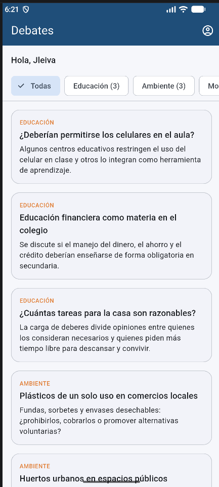
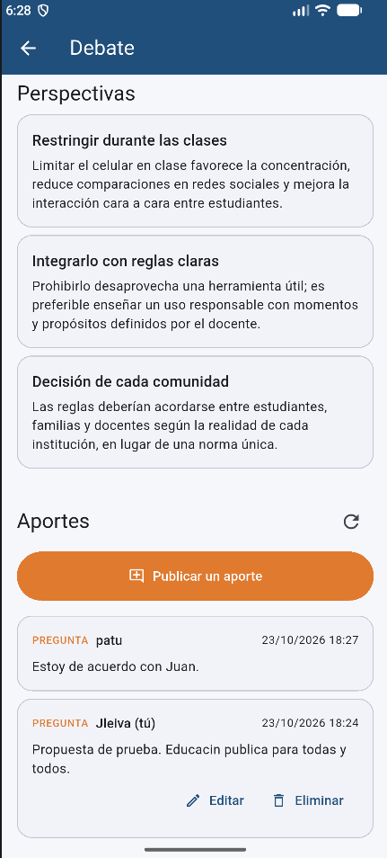
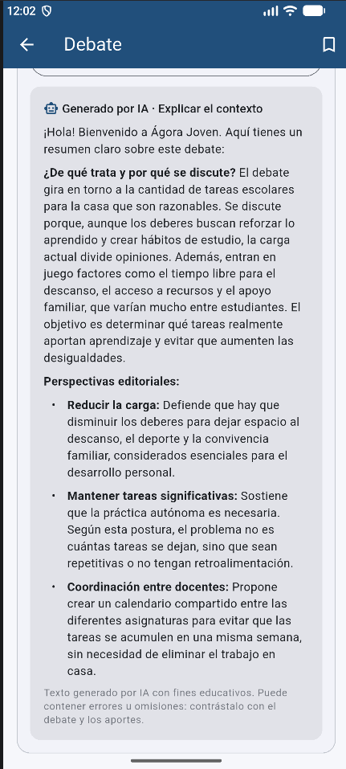

# Ágora Joven

[](https://github.com/jleivalabs/agora-joven/actions/workflows/ci.yml)

App Android (Flutter) para que **personas adultas jóvenes (18 años o más)** comprendan temas
públicos, consulten debates ciudadanos y participen con preguntas, argumentos o propuestas, con un
backend propio (FastAPI) y un asistente educativo con IA (Gemini) que explica el contexto y resume
perspectivas.

Proyecto Final del curso *Desarrolla Aplicaciones Móviles Robustas con Flutter e IA* (CEDIA). Los
20 debates iniciales son **material editorial de demostración** redactado para este proyecto. La
app no está destinada a menores: la edad es una declaración de la persona, no una verificación.

## Estado

| Versión | Estado |
|---|---|
| [v1.0.0](https://github.com/jleivalabs/agora-joven/releases/tag/v1.0.0) | Publicada (APK para el emulador + SHA-256) desde el commit `1ce2f37` y validada por la persona autora en el emulador |
| [v1.1.0](https://github.com/jleivalabs/agora-joven/releases/tag/v1.1.0) (`1.1.0+2`) | Release generada por GitHub Actions desde el commit `382e5f8`; **pendiente** la prueba del APK descargado por la persona autora |

Todas las versiones: [Releases](https://github.com/jleivalabs/agora-joven/releases) · Integración
continua: [Actions](https://github.com/jleivalabs/agora-joven/actions) · Evidencias de cada bloque:
[docs/SEGUIMIENTO.md](docs/SEGUIMIENTO.md).

## Funcionalidades (v1.1.0)

- Registro, inicio y cierre de sesión con JWT; token en almacenamiento seguro y sesión restaurada
  al abrir la app. Declaración obligatoria de 18 años o más.
- Inicio con cifras de la comunidad y de la participación propia.
- Catálogo de debates en el backend (SQLite), con filtro por categoría y detalle.
- Aportes (pregunta, argumento o propuesta) visibles para todas las cuentas; solo su autor puede
  editarlos o eliminarlos (comprobado en el servidor).
- Creación guiada de debates en 6 pasos, con borradores privados y publicación.
- Roles usuario/administrador; el archivo de un debate se solicita y lo revisa la administración.
- Historial de versiones de cada debate; tras el primer aporte el contenido queda protegido y cada
  aporte indica la versión sobre la que se escribió.
- Referencias bibliográficas de **Crossref** (solo metadatos) en los debates creados por usuarios.
  Localizar una obra **no certifica** su calidad ni respalda ninguna afirmación.
- Debates guardados en el dispositivo (Hive), separados por cuenta.
- Asistente educativo con Gemini **a través del backend** (requiere una clave propia en el
  servidor); no publica nada automáticamente.
- CI y Release del APK con GitHub Actions.

No incluido: la redacción con IA del asistente de creación está **desactivada**
(`REDACCION_IA_ACTIVA=false`, probada solo con un proveedor simulado), **no se procesan resúmenes**
de las obras, y no hay investigación científica automatizada, verificación de afirmaciones ni
métricas de consenso. Alcance completo: [docs/ALCANCE.md](docs/ALCANCE.md).

## Capturas

Capturas reales de las pruebas de desarrollo de la v1.0 en el emulador (app ejecutada desde el
código; no muestran funciones de la v1.1). Galería completa: [docs/CAPTURAS.md](docs/CAPTURAS.md).

| Catálogo | Aportes de dos cuentas | Asistente: contexto |
|---|---|---|
|  |  |  |

## Inicio rápido: evaluar la v1.1.0

El APK es para el **emulador Android** y se usa con el **backend de la misma versión** (etiqueta
`v1.1.0`, base en la revisión `0005`). Requisitos: Docker Desktop, un emulador Android (API 24+)
con `adb`, Git y Python 3 (solo para generar el secreto). Guía detallada, otras versiones y
copias de seguridad: [docs/INSTALACION.md](docs/INSTALACION.md).

1. Código de la etiqueta:

   ```powershell
   git clone --branch v1.1.0 --depth 1 https://github.com/jleivalabs/agora-joven.git agora-joven-v1.1.0
   cd agora-joven-v1.1.0\backend
   Copy-Item .env.example .env
   python -c "import secrets; print(secrets.token_urlsafe(48))"
   ```

2. Edita `backend/.env` a mano (no lo compartas ni lo muestres): `JWT_SECRET` = el valor generado
   (obligatorio); `API_PORT=8010`; `GEMINI_API_KEY` opcional (asistente); `CROSSREF_MAILTO`
   opcional (correo de contacto para buscar referencias); `REDACCION_IA_ACTIVA=false`.

3. Backend y comprobación:

   ```powershell
   docker compose up --build -d api
   curl.exe http://localhost:8010/health          # {"status":"ok","servicio":"agora-joven-api"}
   docker compose exec api python -m app.migrar   # "Esquema en la revisión 0005."
   ```

4. Descarga de la [Release v1.1.0](https://github.com/jleivalabs/agora-joven/releases/tag/v1.1.0)
   `agora-joven-v1.1.0-emulador.apk` y su `.sha256`, verifica e instala:

   ```powershell
   Get-FileHash .\agora-joven-v1.1.0-emulador.apk -Algorithm SHA256   # igual que el .sha256
   adb uninstall ec.edu.ute.agora_joven      # si había otra versión instalada
   adb install .\agora-joven-v1.1.0-emulador.apk
   ```

El APK está firmado con una **clave de depuración** distinta en cada Release: hay que desinstalar
la versión anterior, y **desinstalar borra los datos locales** (sesión y debates guardados); las
cuentas, debates y aportes siguen en el backend. El APK v1.0.0 no funciona con este backend: usa
el de su etiqueta en un entorno separado ([guía](docs/INSTALACION.md#versión-anterior-release-v100-apk--backend-de-la-etiqueta)).
Recorrido sugerido: [docs/INSTALACION.md](docs/INSTALACION.md#recorrido-breve-de-la-v110).

## Arquitectura

```text
App Flutter (app/lib)                         Backend FastAPI (backend/app)
screens/      pantallas (sin HTTP)            routers/        auth, debates, aportes, borradores,
controllers/  estado con GetX                                 solicitudes, investigación, asistente…
repositories/ acceso y modelos      ─HTTP──►  repositorios/   consultas SQLAlchemy
data/         Dio, almacén seguro,   JSON      migraciones/    Alembic (SQLite en un volumen Docker)
              Hive                             ia.py, crossref.py  Gemini y Crossref por REST
```

La pantalla llama a un controlador GetX; el controlador usa un repositorio a través de
`SesionController.ejecutar`, que añade el token y descarta respuestas de sesiones anteriores; el
backend comprueba identidad, rol y propiedad en cada petición. Las claves de proveedores viven
solo en el servidor. Capas, contrato de la API y decisiones técnicas:
[docs/ARQUITECTURA.md](docs/ARQUITECTURA.md).

## Validación

- CI en cada push: `flutter analyze`, `flutter test` y `pytest` del backend con Python 3.12, sin
  claves ni llamadas reales a proveedores.
- Última validación local antes del cierre (25/10/2026): 212 pruebas de Flutter y 220 del backend
  (Python 3.12) aprobadas, análisis sin incidencias y APK release compilado. Gemini y Crossref se
  simulan en las pruebas automáticas.
- Recorridos manuales de la persona autora en el emulador, separados entre lo que muestran las
  capturas y lo confirmado: [docs/SEGUIMIENTO.md](docs/SEGUIMIENTO.md).

## Limitaciones

- **APK solo para emulador**, con HTTP hacia `http://10.0.2.2:8010`; un teléfono físico o un
  backend público requieren otra compilación y HTTPS.
- **Firma de depuración**, distinta en cada Release: no se actualiza sobre otra versión ni sirve
  para una tienda; desinstalar borra los datos locales.
- **Asistente educativo:** necesita `GEMINI_API_KEY` en el servidor y depende de la cuota y el
  coste de Gemini; puede equivocarse. Pendiente revisar el tratamiento de datos de Gemini.
- **Redacción con IA del asistente de creación desactivada** y **resúmenes sin procesar**.
- **Referencias:** metadatos de Crossref que no certifican afirmaciones; la búsqueda requiere
  `CROSSREF_MAILTO` y tiene límites por cuenta y hora.
- **Edad:** declaración de la persona, no verificación.

Lista completa: [docs/ALCANCE.md → Limitaciones conocidas](docs/ALCANCE.md#limitaciones-conocidas).

## Documentación

| Documento | Contenido |
|---|---|
| [docs/INSTALACION.md](docs/INSTALACION.md) | Instalación por versión, compatibilidad, volúmenes, restauración, v1.0.0 |
| [docs/DESARROLLO.md](docs/DESARROLLO.md) | Ejecución desde el código, comandos, ejemplos de API, pruebas, tecnologías |
| [docs/ARQUITECTURA.md](docs/ARQUITECTURA.md) | Capas, contrato de la API, modelos y decisiones técnicas |
| [docs/ALCANCE.md](docs/ALCANCE.md) | Alcance, exclusiones, limitaciones y rúbrica |
| [docs/SEGUIMIENTO.md](docs/SEGUIMIENTO.md) | Historia de los bloques, resultados y evidencias |
| [AGENTS.md](AGENTS.md) | Reglas para agentes de código |

## Autoría y créditos

Autoría: Juan Leiva, Proyecto Final del curso de CEDIA. Desarrollo asistido por agentes de código
(ver [AGENTS.md](AGENTS.md)), con revisión y pruebas manuales de la persona autora.

- Debates: material editorial de demostración; no representa posiciones oficiales.
- Servicios externos: Gemini API de Google (clave y condiciones propias) y metadatos de
  [Crossref](https://www.crossref.org/) (REST API pública).
- Paquetes de la app: Flutter (BSD-3), `get` (MIT), `dio` (MIT), `flutter_secure_storage` (BSD-3),
  `hive` y `hive_flutter` (Apache-2.0), `flutter_markdown_plus` y `markdown` (BSD-3),
  `url_launcher` (BSD-3).
- Paquetes del backend: FastAPI (MIT), Uvicorn (BSD-3), SQLAlchemy (MIT), Alembic (MIT), PyJWT
  (MIT), pwdlib (MIT), argon2-cffi (MIT), pydantic-settings (MIT), email-validator (Unlicense).
  Licencias comprobadas en los archivos `LICENSE` o metadatos de los paquetes instalados.
